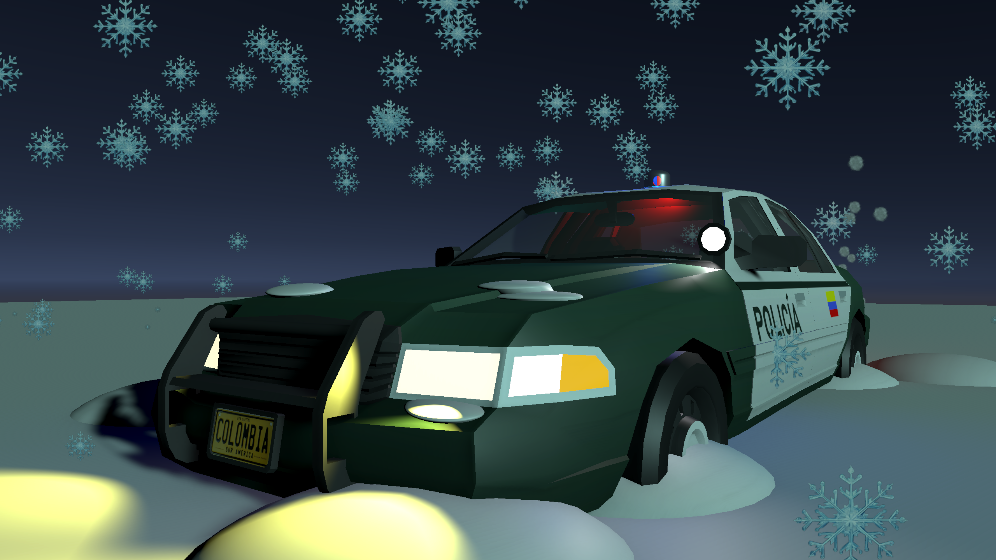

# UnityTaller-Invierno

## Descripción

Proyecto desarrollado en Unity 3D como parte del taller práctico de composición de escenas y control de transformaciones.

El objetivo es construir una escena invernal que represente una patrulla de policía atrapada y parcialmente sepultada bajo la nieve, con las luces de emergencia activadas, humo saliendo del motor y una tormenta de nieve alrededor.

## Vista previa de la escena



## Características implementadas

- **Escenario invernal:** terreno nevado que representa una tormenta de frío extremo.
- **Vehículo policial:** patrulla parcialmente enterrada en la nieve.
- **Sistema de iluminación:** luces de emergencia rojas y azules.
- **Rotación de sirenas:** movimiento controlado mediante un script en C#.
- **Partículas de nieve:** sistema de partículas `Global_Blizzard`.
- **Humo del escape:** sistema de partículas `Exhaust_Smoke`, con expansión y desvanecimiento progresivo.

## Jerarquía de la escena

```text
Scene
├── Main Camera
├── Moon_Light
├── Snow_Terrain
├── Police_Car
│   ├── Car_Mesh
│   ├── Siren_Pivot
│   │   ├── Red_Light
│   │   └── Blue_Light
│   └── Exhaust_Smoke
└── Global_Blizzard
```

## Tecnologías utilizadas

- Unity 3D
- C#
- Unity Particle System
- Git
- GitHub

## Scripts

### SirenRotation.cs

Script encargado de controlar la rotación de las luces de emergencia mediante `Transform.Rotate()` y `Time.deltaTime`.

Permite modificar la velocidad de rotación desde el Inspector mediante una variable pública.

## Sistemas de partículas

| Sistema | Función |
|---|---|
| Global_Blizzard | Simula la caída de nieve sobre el escenario. |
| Exhaust_Smoke | Simula el humo expulsado por el escape del vehículo. |

## Control de versiones

El desarrollo del proyecto se registra mediante commits atómicos en GitHub.

Commits principales:

1. `feat: configuracion inicial del proyecto y escena vacia`
2. `feat: agregar terreno nevado y coche enterrado`
3. `feat: jerarquia de luces y sirenas de emergencia`
4. `feat: implementar script SirenRotation.cs`
5. `feat: integrar particulas de nieve y humo de escape`

## Autor

Desarrollado como parte del taller práctico de Unity 3D.

---

**Proyecto académico – Desarrollo de Videojuegos**